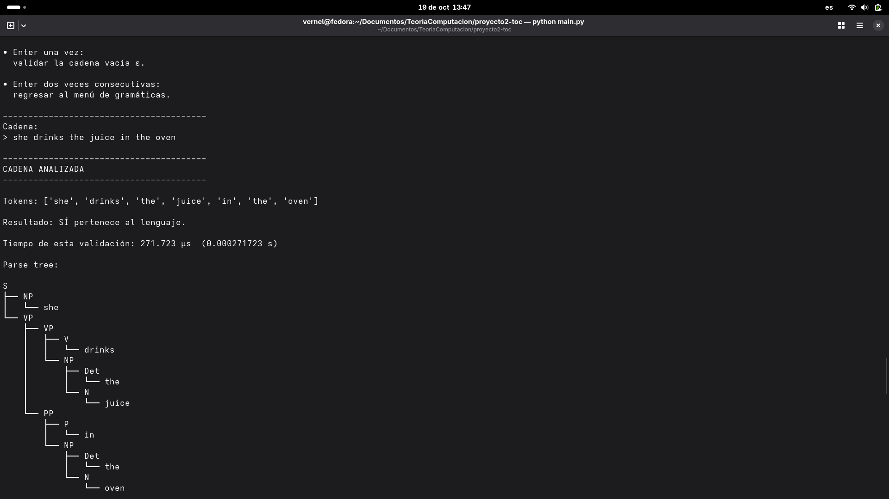
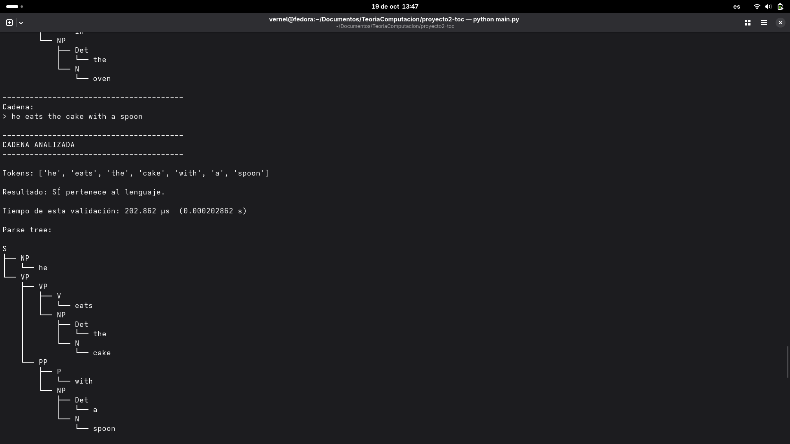
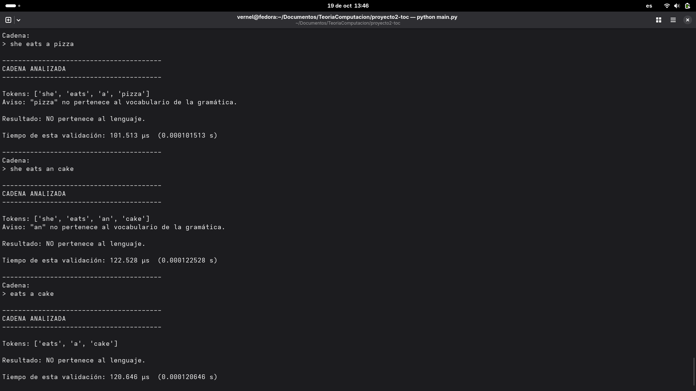

# Proyecto No. 2 — CYK y Forma Normal de Chomsky

Programa en Python para leer una Gramática Independiente del Contexto, simplificarla, convertirla a Forma Normal de Chomsky y determinar mediante CYK si una cadena pertenece al lenguaje generado.

**Curso:** CC2019 — Teoría de la Computación
**Universidad:** Universidad del Valle de Guatemala
**Profesor:** Bidkar Pojoy

**Integrantes:**
- Vernel Josué Hernández Cáceres — 24584
- Derek Friedhelm Coronado Chilin — 24732

## Video explicativo

**Enlace:** https://youtu.be/vIQZmSyZx8U

---

## Índice

1. [Objetivo del proyecto](#1-objetivo-del-proyecto)
2. [Flujo general](#2-flujo-general)
3. [Metodología adoptada](#3-metodología-adoptada)
4. [Gramáticas incluidas](#4-gramáticas-incluidas)
5. [Arquitectura](#5-arquitectura)
6. [Modelo de datos](#6-modelo-de-datos)
7. [Transformación G0 → G6](#7-transformación-g0--g6)
8. [Algoritmo CYK](#8-algoritmo-cyk)
9. [Backpointers y parse tree](#9-backpointers-y-parse-tree)
10. [Decisiones de implementación en Python](#10-decisiones-de-implementación-en-python)
11. [Decisiones y criterios adoptados](#11-decisiones-y-criterios-adoptados)
12. [Discusión](#12-discusión)
13. [Estrategia de validación](#13-estrategia-de-validación)
14. [Tests automatizados](#14-tests-automatizados)
15. [Ejecución](#15-ejecución)
16. [Ejemplo completo](#16-ejemplo-completo-1txt)
17. [Ejemplos con la gramática English](#17-ejemplos-con-la-gramática-english)
18. [Limitaciones y alcance](#18-limitaciones-y-alcance)
19. [Organización del proyecto](#19-organización-del-proyecto)
20. [Referencias bibliográficas](#20-referencias-bibliográficas)

---

## 1. Objetivo del proyecto

El programa:

1. recibe una CFG escrita en un archivo `.txt` o ingresada por terminal;
2. valida su sintaxis línea por línea y reporta errores con número de línea;
3. la simplifica (nuevo símbolo inicial, producciones-ε, producciones unitarias y símbolos inútiles);
4. la transforma a Forma Normal de Chomsky (aislamiento de terminales y binarización);
5. verifica formalmente que la gramática resultante está en CNF;
6. recibe una cadena escrita textualmente;
7. ejecuta CYK con programación dinámica;
8. responde **SÍ** o **NO**;
9. mide el tiempo de esa validación;
10. reconstruye un parse tree cuando la cadena pertenece al lenguaje.

Todo el procedimiento intermedio se muestra en la terminal, no solo el resultado final.

## 2. Flujo general

```text
Gramática CFG (.txt o entrada manual)
    ↓
Lectura y validación
    ↓
G0  gramática original
    ↓
Fase 0 — nuevo símbolo inicial
    ↓
G1
    ↓
Fase 1 — eliminar producciones-ε
    ↓
G2
    ↓
Fase 2 — eliminar producciones unitarias
    ↓
G3
    ↓
Fase 3 — eliminar símbolos inútiles (3a generadores, 3b alcanzables)
    ↓
G4
    ↓
Fase 4 — aislar terminales
    ↓
G5
    ↓
Fase 5 — binarizar
    ↓
G6  gramática final
    ↓
Validación CNF
    ↓
Cadena → tokens → CYK
    ↓
SÍ / NO + tiempo + parse tree
```

`G0` es siempre la gramática de entrada y `G6` la gramática final en CNF. Cada fase produce la siguiente versión aunque no haya cambiado nada; en ese caso el programa lo indica explícitamente (`G2 = G1`).

## 3. Metodología adoptada

La implementación no se limitó a obtener la gramática final. El procedimiento se estructuró siguiendo la metodología utilizada durante el Laboratorio 7, la preparación y resolución de los ejercicios del Corto No. 2, y el ejemplo de transformación a CNF proporcionado por el ingeniero Bidkar Pojoy para el proyecto. En todos esos casos el patrón de trabajo es el mismo:

```text
identificar
    ↓
construir la información necesaria (conjuntos, tablas)
    ↓
iterar hasta punto fijo
    ↓
transformar
    ↓
escribir la nueva gramática
```

Cada fase primero calcula la información que necesita (por ejemplo, el conjunto de variables anulables), la muestra mediante tablas de punto fijo, realiza la transformación y por último construye una nueva gramática `Gk`. La información y la transformación nunca se mezclan en un mismo paso.

Esta decisión permite:

- **demostrar el procedimiento**, igual que en una solución a mano;
- **detectar errores intermedios**, porque cada tabla puede compararse contra el cálculo manual;
- **comparar contra ejercicios ya resueltos**, que se convirtieron en pruebas automatizadas;
- **defender el resultado**, ya que cada gramática intermedia es visible y justificada.

### ¿Por qué mostrar todas las fases?

Una fase que no modifica la gramática sigue siendo un resultado válido del procedimiento:

```text
N = ∅                          ⇒ la Fase 1 no modifica la gramática: G2 = G1
No hay producciones unitarias  ⇒ G3 = G2
Ningún terminal acompañado     ⇒ no se crean envoltorios: G5 = G4
```

Escribirlo demuestra que la condición fue revisada y no simplemente omitida. Es la misma regla que se aplica al resolver los ejercicios a mano: cuando una fase no encuentra nada, se escribe y se justifica. Con `english.txt`, que ya está en CNF, las seis fases terminan en `Gk = Gk-1`, y aun así el programa muestra cada tabla y cada conclusión.

## 4. Gramáticas incluidas

### Gramáticas proporcionadas por Bidkar Pojoy

| Archivo | Descripción |
|---|---|
| `grammars/english.txt` | Gramática principal del proyecto: frases simples en inglés (`She eats a cake with a fork`). Ya cumple CNF, por lo que ninguna fase la modifica. |
| `grammars/1.txt` | Gramática de expresiones aritméticas (`E -> T X`, `F -> ( E ) \| id`, …) proporcionada **fuera de CNF**. Pasa por las seis fases. |
| `grammars/1-cnf.txt` | Versión de la gramática de expresiones proporcionada **ya en CNF**. Se procesa con el mismo flujo; los únicos cambios son el nuevo inicial `E0` y la transferencia de su producción unitaria, y las Fases 1, 3, 4 y 5 concluyen `Gk = Gk-1`. |

### Ejercicios propios utilizados para validación

| Archivo | Origen |
|---|---|
| `grammars/test_lab7.txt` | Laboratorio 7, Ejercicio 1 |
| `grammars/test_guia.txt` | Ejemplo de la guía de estudio del Corto 2 |
| `grammars/test_practica.txt` | Ejercicio de práctica (nivel corto) |
| `grammars/test_corto_p3.txt` | Corto 2, Problema 3 (producciones-ε) |
| `grammars/test_corto_p4.txt` | Corto 2, Problema 4 (unitarias con ciclo) |
| `grammars/test_corto_p5.txt` | Corto 2, Problema 5 (cadena completa) |
| `grammars/test_long_rules.txt` | Binarización de lados derechos largos |

Estas gramáticas adicionales **no** se presentan como material oficial del Proyecto 2. Se incorporaron como casos conocidos, regresiones y comprobaciones contra soluciones manuales: varias fueron resueltas previamente a mano durante el laboratorio y la preparación del corto, y después se usaron como oráculo para verificar la implementación.

### Formato de los archivos

```text
VARIABLE -> alternativa | alternativa
```

- Un solo símbolo en el lado izquierdo y `->` obligatorio.
- Los símbolos del lado derecho se separan por espacios; `|` separa alternativas.
- `ε` (o la palabra `epsilon`) representa la cadena vacía.
- Variables: los símbolos que aparecen en algún lado izquierdo. Terminales: todo lo demás, incluidos `(`, `)`, `+`, `*` e `id`.
- La primera variable del archivo es el símbolo inicial.
- Las líneas vacías y las que empiezan con `#` se ignoran.

## 5. Arquitectura

```text
proyecto2-toc/
├── main.py                          # CLI: menú, preparación de la gramática, validación de cadenas
├── README.md
├── grammars/
│   ├── english.txt  1.txt  1-cnf.txt
│   └── test_lab7.txt  test_guia.txt  test_practica.txt
│       test_corto_p3.txt  test_corto_p4.txt  test_corto_p5.txt  test_long_rules.txt
├── src/
│   ├── model/
│   │   ├── grammar.py               # Grammar (V, Σ, R, S) inmutable y validada
│   │   ├── production.py            # Production(lhs, rhs); () representa ε
│   │   ├── trace.py                 # Trace: tablas y notas de una fase
│   │   ├── backpointer.py           # TerminalBackPointer, BinaryBackPointer
│   │   ├── parse_node.py            # ParseNode
│   │   └── cyk_result.py            # CYKResult
│   ├── input/
│   │   ├── grammar_loader.py        # lee el archivo conservando números de línea
│   │   ├── grammar_validator.py     # sintaxis de cada producción, errores con línea
│   │   ├── grammar_parser.py        # líneas validadas → Grammar (archivo y entrada manual)
│   │   └── sentence_parser.py       # oración → tokens
│   ├── algorithms/
│   │   ├── grammar_tools.py         # punto fijo genérico, reconstrucción, coordinación de fases
│   │   ├── simplification/
│   │   │   ├── start_symbol.py      # Fase 0
│   │   │   ├── epsilon.py           # Fase 1
│   │   │   ├── unit.py              # Fase 2
│   │   │   ├── useless.py           # Fase 3
│   │   │   └── simplify.py          # simplify(): Fases 0–3
│   │   ├── chomsky/
│   │   │   ├── terminals.py         # Fase 4
│   │   │   ├── binarize.py          # Fase 5
│   │   │   ├── converter.py         # to_cnf(): Fases 4–5
│   │   │   └── validator.py         # is_cnf(), cnf_violations()
│   │   └── cyk/
│   │       ├── table.py             # índices de producciones y tabla CYK
│   │       ├── parser.py            # recognize_cyk(), parse_cyk(), benchmark_cyk()
│   │       └── reconstruction.py    # parse tree desde los backpointers
│   ├── output/
│   │   ├── trace_formatter.py       # fases numeradas, G0–G6, validación CNF
│   │   ├── formatter.py             # tokens, resultado, tiempos, tabla CYK, avisos
│   │   └── tree_formatter.py        # parse tree en texto
│   └── utils/
│       ├── naming.py                # nombres auxiliares sin colisiones (S0, U_a, X1)
│       ├── notation.py              # ε, ∅, texto de producciones y conjuntos
│       └── timer.py                 # perf_counter_ns y mediana
└── tests/                           # 20 archivos de pruebas + grammar_helpers.py
```

| Capa | Responsabilidad |
|---|---|
| `main.py` | Única capa que lee la terminal e imprime. Compone entrada → simplificación → CNF → CYK → salida. |
| `grammars/` | Gramáticas oficiales y de validación en formato `.txt`. |
| `src/input/` | Carga, valida y construye la `Grammar`. Reporta errores con número de línea y avisos de símbolos sospechosos. |
| `src/model/` | Estructuras de datos inmutables: gramática, producciones, trazas, backpointers, árbol y resultado de CYK. |
| `src/algorithms/simplification/` | Fases 0–3. Cada fase recibe una `Grammar` y devuelve `(Grammar, Trace)`. |
| `src/algorithms/chomsky/` | Fases 4–5 y validador formal de CNF. |
| `src/algorithms/cyk/` | Índices, tabla de programación dinámica, aceptación, tiempo, benchmark y reconstrucción del árbol. |
| `src/output/` | Convierte trazas, resultados y árboles a texto. No calcula nada. |
| `src/utils/` | Nombres frescos, notación y medición de tiempo. |
| `tests/` | Pruebas unitarias, de integración y de regresión con `unittest`. |

### Algoritmos puros

Los módulos de `src/algorithms/` no leen archivos, no imprimen y no conocen la terminal. Reciben una `Grammar` y devuelven una nueva `Grammar` junto con una `Trace`, o el resultado correspondiente en el caso de CYK. Cuando una fase no cambia nada, devuelve el mismo objeto de entrada con su traza justificada.

Esta separación permite probar cada fase de manera unitaria, mantener trazabilidad del procedimiento, reutilizar los algoritmos desde la interfaz o desde los tests, y evitar que la lógica se mezcle con la presentación. `main.py` no contiene lógica algorítmica.

## 6. Modelo de datos

| Modelo | Qué representa | Por qué existe |
|---|---|---|
| `Grammar` | G = (V, Σ, R, S). `variables` y `terminals` son `frozenset`; `productions` es una tupla sin duplicados. | Valida sus invariantes al construirse (S ∈ V, V ∩ Σ = ∅, símbolos declarados) y garantiza que cada `Gk` sea un valor independiente. |
| `Production` | Una producción `A -> α`; el lado derecho es una tupla y `()` representa ε. | Hashable y comparable por valor, lo que permite deduplicar y usar las producciones en tablas. |
| `Trace` | Tablas y notas producidas por una fase, más la gramática resultante. | Conserva el procedimiento de la fase para que la capa de salida lo muestre. |
| `TerminalBackPointer` / `BinaryBackPointer` | Cómo se obtuvo una variable en una celda de CYK: por `A -> a` o por `A -> B C` con un corte concreto. | Permiten reconstruir el parse tree sin volver a ejecutar el algoritmo. |
| `ParseNode` | Un nodo del árbol: símbolo, token (en las hojas) e hijos. | Representación del parse tree independiente del formato de salida. |
| `CYKResult` | Aceptación, tabla, parse tree y tiempo de una validación. | Agrupa todo lo que la interfaz necesita mostrar tras una sola llamada. |

## 7. Transformación G0 → G6

### G0 — gramática original

La entrada tal como se leyó, sin transformar. El programa la muestra completa junto con |V|, |Σ|, |R| y el símbolo inicial antes de comenzar.

### Fase 0 → G1: nuevo símbolo inicial

Se introduce `S0 -> S` cuando el símbolo inicial aparece en algún lado derecho. En CNF el inicial no puede estar a la derecha de ninguna producción, porque de lo contrario `S0 -> ε` podría introducirse en medio de una derivación. Si el inicial no aparece a la derecha, se conserva y la fase concluye `G1 = G0`. El nombre se elige sin colisiones: si `S0` ya existe en la gramática, se usa `S0_1`.

### Fase 1 → G2: eliminación de producciones-ε

1. **Conjunto Nullable (punto fijo).** Base: variables con `X -> ε`. Iteración: X es anulable si alguna de sus producciones tiene todos los símbolos del lado derecho anulables. Se repite hasta que el conjunto no cambia; la tabla muestra cada iteración.
2. **Variantes.** Por cada **ocurrencia** anulable del lado derecho se consideran las opciones conservar/quitar: con `m` ocurrencias se generan `2^m` casos (en `A -> B B` con B anulable, `m = 2`). Los terminales nunca se quitan; una variable solo se deja o se borra, nunca se reemplaza.
3. Se eliminan las producciones-ε y los duplicados. Solo el símbolo inicial conserva `ε`, y únicamente cuando ε pertenece al lenguaje.

### Fase 2 → G3: eliminación de producciones unitarias

Una producción unitaria tiene exactamente una variable como lado derecho (`A -> B`). Se calculan los **pares unitarios** (X, Y) tales que X ⇒* Y usando solo unitarias; todo X forma par consigo mismo y los ciclos se resuelven solos. Después se **transfieren** a cada X las producciones no unitarias de todo Y con el que forma par, y se eliminan las unitarias. Las variables que quedan inalcanzables no se eliminan aquí: eso corresponde a la Fase 3.

### Fase 3 → G4: eliminación de símbolos inútiles

El orden es obligatorio:

- **3a. Generadoras (punto fijo).** Base: variables con alguna producción formada solo por terminales (o ε). Iteración: X es generadora si tiene una producción cuyos símbolos son terminales o generadoras. Se eliminan las no generadoras y toda producción que las contenga.
- **3b. Alcanzables (punto fijo).** Base: el símbolo inicial. Se agregan las variables que aparecen en los lados derechos de variables ya alcanzables. Se eliminan las inalcanzables.

3b se calcula sobre la gramática que dejó 3a, porque eliminar una variable no generadora puede dejar inalcanzable a otra. Si el inicial no es generador, L(G) = ∅ y el programa lo reporta.

### Fase 4 → G5: aislar terminales

En todo lado derecho de longitud ≥ 2, cada terminal `a` se reemplaza por una variable envoltorio `U_a` con la única producción `U_a -> a`. Las producciones `A -> a` ya son válidas y no se tocan. Si `U_a` ya existe exactamente como `U_a -> a` se reutiliza; si existe con otro significado se genera un nombre libre.

### Fase 5 → G6: binarizar

`A -> B1 B2 … Bk` con k > 2 se convierte en `A -> B1 X1`, `X1 -> B2 X2`, …, `X(k-2) -> B(k-1) Bk`. Se crean k − 2 variables nuevas por producción, con índices que saltan los nombres ya usados por la gramática.

### Validación final

`G6` debe pasar el validador antes de ejecutar CYK. El validador acepta únicamente `A -> B C` con variables, `A -> a` con terminal, y `S -> ε` solo si S es el símbolo inicial y no aparece en ningún lado derecho. Cualquier otra producción se reporta con su motivo. CYK nunca se ejecuta sobre una gramática que no lo supere.

## 8. Algoritmo CYK

CYK trabaja sobre **subcadenas contiguas**. Para tokens `w0 … w(n-1)`, la celda `T[i][j]` contiene las variables que derivan exactamente `tokens[i … j]`; solo se usa el triángulo superior de la tabla.

### Índices de producciones

Antes de llenar la tabla se construyen dos índices a partir de la CNF:

```text
terminal_index[token]  = variables A con A -> token
binary_index[(B, C)]   = variables A con A -> B C
```

Así cada celda consulta directamente las producciones aplicables en lugar de recorrer toda la gramática. Los valores conservan el orden de las producciones, lo que hace determinista el recorrido.

### Caso base

Para cada posición `i`, las producciones `A -> token` llenan la diagonal `T[i][i]`. Un token que no tiene ninguna producción deja su celda vacía; no se rechaza por adelantado, la frase pasa igual por el algoritmo.

### Paso inductivo

Los spans se recorren por longitud creciente. Para `T[i][j]` se prueban **todos** los cortes `i ≤ k < j`: si `B ∈ T[i][k]`, `C ∈ T[k+1][j]` y existe `A -> B C`, entonces `A ∈ T[i][j]`. Cada subproblema se resuelve una sola vez y se reutiliza en los spans mayores; ese es el patrón de programación dinámica.

### Aceptación

```text
accepted = grammar.start_symbol in T[0][n - 1]
```

No basta con que la celda final tenga algún símbolo: puede contener otras variables sin contener al inicial, y en ese caso la cadena **no** pertenece al lenguaje. La decisión se toma siempre sobre `grammar.start_symbol`, que tras la Fase 0 puede ser `S0`, `E0`, etc.

La cadena vacía se decide sin construir tabla: se acepta solo si existe `inicial -> ε`.

## 9. Backpointers y parse tree

Cada variable que entra en una celda guarda cómo se obtuvo:

- `TerminalBackPointer(token)` en la diagonal, para `A -> token`;
- `BinaryBackPointer(production, split, left_symbol, right_symbol)` en los spans, para `A -> B C` con el corte `k` usado.

Si la cadena es aceptada, la reconstrucción parte de `T[0][n-1][inicial]` y sigue los backpointers de forma recursiva hasta las hojas. El resultado es un `ParseNode` que después se dibuja en texto.

Se guarda **un solo testigo por (i, j, A)**: el primero encontrado. El requisito del proyecto es producir *un* parse tree, no enumerar todos los árboles posibles de una gramática ambigua. Como la tabla se recorre en orden determinista (longitud, inicio, corte y variables ordenadas), la misma cadena produce siempre el mismo árbol.

El árbol corresponde a la gramática CNF utilizada para el reconocimiento. En la presentación, las variables introducidas únicamente por la conversión (`S0`, `U_*`, `X*`) se detectan por diferencia de conjuntos entre `G6` y `G0`, nunca por su nombre, y se colapsan para que el árbol recupere la forma de las reglas originales. Con `english.txt` no hay variables sintéticas, así que el árbol se muestra tal cual.

## 10. Decisiones de implementación en Python

| Decisión | Dónde | Por qué |
|---|---|---|
| `frozenset` para `variables` y `terminals` | `Grammar` | Un conjunto mutable permitiría que una fase alterara la gramática anterior por accidente. Con `frozenset`, `G0`, `G1`, … son valores separados, los snapshots de los algoritmos de punto fijo son estables y se conserva la semántica de conjunto (sin orden ni duplicados). |
| `tuple` para el lado derecho | `Production` | El RHS tiene orden y no debe mutar; una tupla es hashable, lo que permite comparar y deduplicar producciones. |
| `@dataclass(frozen=True)` | `Grammar`, `Production`, backpointers, `ParseNode`, `CYKResult`, `ValidatedRule`, `ParseResult` y otros | Elimina código repetitivo, genera igualdad por valor y obliga a que cada fase construya objetos nuevos. `Trace` es el único modelo mutable: acumula tablas y notas mientras la fase se ejecuta. |
| `dict.fromkeys` | parser, Fases 2–4, tabla de producciones | Deduplica conservando el orden de primera aparición, que `set` no garantiza. Así las variables, las producciones y las tablas salen siempre en el mismo orden. |
| `collections.deque` | cierre de pares unitarios (`unit.py`) | El recorrido en anchura extrae por el frente con `popleft()` en O(1); `list.pop(0)` desplazaría toda la lista en cada paso. |
| `itertools.combinations` | variantes de la Fase 1 | Las `2^m` variantes son exactamente los subconjuntos de ocurrencias anulables a eliminar; `combinations` los enumera por tamaño sin lógica manual. |
| `time.perf_counter_ns` | `utils/timer.py` | Contador de alta resolución en enteros, apropiado para intervalos de microsegundos sin pérdida de precisión por `float`. Solo se mide el bloque indicado en §11.6. |
| `statistics.median` | `benchmark_cyk` | Con `--runs N` se reporta la mediana de N ejecuciones, menos sensible a valores atípicos que el promedio. |
| `unicodedata.normalize("NFKC")` | `sentence_parser.py` | Las oraciones copiadas desde el PDF del enunciado llegan con letras matemáticas (`𝑆ℎ𝑒`); NFKC las convierte a ASCII antes de tokenizar. |

No se usan dependencias externas: todo el proyecto funciona con la biblioteca estándar y los tests se ejecutan con `unittest`.

## 11. Decisiones y criterios adoptados

### 11.1. Conservación del alfabeto terminal Σ

Durante la eliminación de símbolos inútiles pueden desaparecer producciones que usaban un terminal. Sin embargo, al reconstruir cada `Gk` el modelo conserva `grammar.terminals` tal como fue declarado. Por tanto puede ocurrir que `c ∈ Σ` aunque ninguna producción de `G6` use `c`.

Esta decisión se defiende por cuatro razones:

1. no cambia el lenguaje generado;
2. un terminal sin producciones simplemente no participa en ninguna derivación;
3. mantiene estable el alfabeto declarado originalmente a lo largo de todas las fases;
4. CYK reconoce usando las producciones disponibles (`terminal_index`), no la mera existencia del símbolo en Σ. Por eso el aviso de "token fuera del vocabulario" se calcula a partir de las reglas `A -> a` de la CNF.

Otra implementación podría recalcular Σ tras cada transformación; esa convención también es válida. En este proyecto se escogió conservar el alfabeto declarado:

> Σ representa el alfabeto declarado de la gramática, no necesariamente el conjunto mínimo de terminales que aún aparecen en R.

### 11.2. Diferencia entre `e` y `ε`

El validador define:

```python
EPSILON_SYMBOLS = frozenset({"ε", "epsilon"})
```

- `ε` representa la cadena vacía.
- La palabra `epsilon` también se acepta como notación de cadena vacía.
- Cualquier otro símbolo, incluida la letra `e`, es un terminal normal.

Esto importa en la gramática de expresiones `1.txt`:

```text
X -> + T X | e
Y -> * F Y | e
```

Aquí `e` es un terminal: `X -> e` y `Y -> e` son producciones terminales válidas, X e Y **no** son anulables y la Fase 1 concluye `N = ∅`. Una cadena como `id e e` pertenece al lenguaje y `id` no. Si se desea la cadena vacía, debe escribirse `ε` o `epsilon`.

### 11.3. Orden de simplificación

```text
ε → unitarias → inútiles → aislar terminales → binarizar
```

- Eliminar ε puede crear unitarias nuevas (`S -> A B` con A anulable genera `S -> B`), así que las unitarias se eliminan después.
- Transferir unitarias puede dejar variables inalcanzables, así que los inútiles se eliminan después.
- Limpiar antes de binarizar evita crear variables auxiliares para producciones que luego se borrarían.

### 11.4. Recursividad izquierda y factorización

No se implementan. Son transformaciones asociadas a estrategias de análisis descendente/predictivo (LL(1)), no requisitos de CYK. Una producción recursiva por la izquierda puede estar perfectamente en CNF: `VP -> VP PP` en `english.txt` ya tiene la forma `A -> B C`. Es una decisión de alcance, no una carencia.

### 11.5. Un solo backpointer por celda

El proyecto debe construir un parse tree, no todos los árboles posibles. Guardar un único testigo reduce el almacenamiento de la tabla, simplifica la reconstrucción y satisface el requisito. El recorrido determinista garantiza que el testigo elegido sea siempre el mismo.

### 11.6. Medición de tiempo

`parse_cyk` mide únicamente:

```text
construcción de la tabla CYK + decisión de aceptación
```

La validación CNF ocurre **antes** de iniciar el cronómetro y la reconstrucción del parse tree ocurre **después** de detenerlo. La lectura del archivo, la simplificación, la conversión a CNF y la impresión tampoco forman parte del tiempo reportado. Para la cadena vacía se mide solo la comprobación de `inicial -> ε`.

El valor se reporta en µs y en segundos. Con `--runs N` (N > 1) el programa ejecuta además N reconocimientos adicionales sin reconstruir árboles y muestra su mediana como benchmark, separada del tiempo de la validación individual. La decisión SÍ/NO siempre proviene de la ejecución individual.

## 12. Discusión

### Obstáculos encontrados

**Distinguir `e` de `ε`.** La gramática de expresiones proporcionada contiene `X -> + T X | e` y `Y -> * F Y | e`, donde `e` es un terminal literal y no la cadena vacía. Tratarlo como ε habría hecho anulables a `X` y `Y`, cambiado el conjunto Nullable, generado variantes incorrectas en la Fase 1 y alterado la CNF final y las cadenas aceptadas por CYK. Fue necesario fijar explícitamente que solo `ε` y la palabra `epsilon` representan la cadena vacía, y proteger esa distinción con pruebas de regresión que recorren el parser, el pipeline completo y CYK.

**Conservar la equivalencia durante CFG → CNF.** No bastaba con obtener una gramática que "pareciera" CNF. Cada transformación debía preservar el lenguaje, evitar colisiones entre las variables auxiliares (`S0`, `U_a`, `X1`) y las variables del usuario, controlar los duplicados, respetar el símbolo inicial activo y manejar ε solo donde corresponde. Por eso el procedimiento se dividió en versiones explícitas `G0 → G6`, cada una validada como `Grammar`, y el resultado final pasa por el validador CNF antes de que CYK se ejecute. La equivalencia se comprobó además con un oráculo que enumera las palabras de longitud acotada de la gramática original y de la final.

**Validar las fases intermedias.** Un error temprano en el cálculo de anulables, en el cierre de unitarias, en los conjuntos de generadoras o alcanzables, en los envoltorios o en la binarización se propaga a todas las fases siguientes y produce una CNF que acepta o rechaza cadenas incorrectas. Al resolver los ejercicios a mano ese efecto en cascada ya se había observado. Por ello se adoptó la metodología de identificar, calcular la información, iterar hasta punto fijo, transformar y escribir la nueva gramática, y cada fase se comparó por separado contra ejercicios resueltos previamente antes de implementar la siguiente.

**Reconstruir el parse tree.** Decidir SÍ/NO no era suficiente: el enunciado exige construir el árbol. Eso obligó a que CYK conservara, durante el llenado de la tabla, un backpointer por cada variable reconocida en cada celda, indicando qué producción, qué corte y qué subproblemas la originaron. El árbol se reconstruye directamente desde esa información, sin volver a analizar la cadena, y el recorrido determinista de la tabla garantiza que la misma cadena produzca siempre el mismo árbol.

**Validar con gramáticas diferentes.** `english.txt` ya está en CNF, de modo que por sí sola no ejercita ninguna transformación. Validar únicamente con ella habría dejado sin probar las Fases 0–5. Se incorporaron los ejercicios resueltos a mano, la gramática de expresiones fuera de CNF y la versión ya en CNF proporcionada; cada una activa fases distintas (ε en el Laboratorio 7, ciclos unitarios en el Corto P4, binarización en `1.txt`) y permitió detectar casos que la gramática principal no cubre.

### Recomendaciones

**Verificar cada fase antes de avanzar.** Convertir una CFG a CNF en una sola transformación opaca dificulta localizar errores. Es preferible tratar ε, unitarias, inútiles, terminales acompañados y binarización como pasos separados, con su propia gramática resultante y su propia prueba.

**Usar ejercicios resueltos a mano como oráculos.** Una implementación algorítmica debe contrastarse con resultados conocidos. La secuencia solución manual → test → implementación → regresión convierte cada ejercicio del curso en una comprobación permanente y evita que una corrección posterior reintroduzca un error.

**Mantener la separación de responsabilidades.** Separar entrada, modelo, algoritmos y presentación permite probar los algoritmos sin terminal, reutilizarlos desde la interfaz y desde los tests, y cambiar la presentación sin tocar la lógica.

**Validar CNF antes de ejecutar CYK.** CYK no debe confiar ciegamente en la etapa anterior. Una comprobación formal de las tres formas permitidas (`A -> B C`, `A -> a` y `S -> ε` bajo su condición) detecta de inmediato cualquier producción que la conversión haya dejado mal formada.

**Probar aceptación y rechazo.** Una suite que solo contiene cadenas válidas es insuficiente. Deben probarse cadenas pertenecientes, cadenas no pertenecientes, tokens fuera del vocabulario, la cadena vacía cuando aplique y casos estructurales en los que todos los símbolos son conocidos pero la cadena no puede derivarse desde el símbolo inicial.

## 13. Estrategia de validación

```text
resolver o conocer el resultado manual
    ↓
convertir ese resultado en un oráculo (test)
    ↓
implementar la fase
    ↓
comparar la salida del programa con el oráculo
    ↓
conservar el caso como test de regresión
```

Los oráculos provienen del Laboratorio 7, los ejercicios de la guía, la práctica, el Corto No. 2 y las gramáticas oficiales. Además, un oráculo independiente (`tests/grammar_helpers.language`) genera todas las palabras de longitud acotada de la gramática original y de la CNF final y comprueba que coinciden; es una comprobación empírica de que las transformaciones conservan el lenguaje.

| Caso | Qué valida |
|---|---|
| Laboratorio 7 | S anulable, ciclo unitario S–A–B–C, inalcanzables tras transferir; G3 reproducida exactamente |
| Guía | Pipeline completo: B no generadora, C inalcanzable, binarización de `a S b` |
| Práctica | Anulables, C no generadora, D inalcanzable, tres envoltorios |
| Corto P3 | Variantes `2^m` con m = 3 (ocho variantes de `S -> A B C d`) |
| Corto P4 | Ciclo de unitarias A ↔ B |
| Corto P5 | No generadores e inalcanzables encadenados |
| Long Rules | Binarización con k = 4 (`X1`, `X2`) |
| `1.txt` | Gramática oficial fuera de CNF: E0, N = ∅, envoltorios de `+ * ( )`, X1–X3 |
| `1-cnf.txt` | Gramática oficial ya en CNF: solo cambian las Fases 0 y 2 por el nuevo inicial E0; las demás concluyen `Gk = Gk-1` |
| English | Reconocimiento CYK: cuatro frases aceptadas y cuatro rechazadas |

## 14. Tests automatizados

```bash
python -m unittest discover -v
```

Resultado actual: **475 tests PASS**.

| Nivel | Archivos | Qué cubre |
|---|---|---|
| Unitarios | `test_model`, `test_loader`, `test_validator`, `test_parser`, `test_naming`, `test_sentence_parser`, `test_fase0_start` … `test_fase5_binarize`, `test_cnf_validator`, `test_cyk`, `test_parse_tree`, `test_formatter`, `test_trace_formatter` | Cada modelo, cada fase, el validador, la tabla CYK, los backpointers y los formatters, con casos borde (colisiones de nombres, ε, lenguaje vacío, token desconocido) |
| Integración | `test_cnf_pipeline`, `test_integration` | Las diez gramáticas pasan el pipeline completo y terminan en CNF; equivalencia de lenguaje acotada; `python main.py` ejecutado como subproceso con sus opciones, el menú, la entrada manual y los caminos de error |
| Regresión | `test_cli`, `test_integration`, `test_parser` | Compatibilidad de la CLI, numeración del menú y casos que protegen comportamientos concretos |

Una regresión específica protege la gramática simbólica:

```text
F -> ( E ) | id
```

Verifica que `(`, `)`, `+`, `*` e `id` se traten como terminales literales, que la producción se separe en `F -> ( E )` y `F -> id`, que el archivo y la entrada manual produzcan la misma `Grammar`, y que `e` siga siendo un terminal distinto de `ε` en todo el pipeline, desde el parser hasta CYK.

Determinismo: la salida completa de las trazas es idéntica entre ejecuciones y con distintos valores de `PYTHONHASHSEED`, porque ningún resultado visible depende del orden de iteración de un `set`.

## 15. Ejecución

Requisitos: Python 3 (el proyecto se desarrolló con Python 3.14) y ninguna dependencia externa.

```bash
cd proyecto2-toc
python main.py
```

En una terminal interactiva aparece el menú:

```text
========================================
         SELECCIÓN DE GRAMÁTICA
========================================

Gramáticas proporcionadas por Bidkar Pojoy:

1. English
2. 1.txt — Gramática de expresiones
3. 1-cnf.txt — Gramática de expresiones en CNF

Ejercicios propios de prueba:

4. Laboratorio 7
5. Guía
6. Práctica
7. Corto P3
8. Corto P4
9. Corto P5
10. Long Rules

Otras opciones:

11. Ingresar gramática manualmente
0. Salir

Opción:
>
```

Al elegir una gramática el programa muestra `G0`, el procedimiento completo de las seis fases con sus tablas y pasos numerados, la gramática final `G6` y la validación CNF. Después entra en la validación de cadenas:

- cada línea no vacía se valida con CYK (todo texto es una cadena; `0`, `1` o `volver` no son comandos);
- un **Enter** vacío valida la cadena vacía ε;
- dos **Enter** consecutivos regresan al menú.

Las oraciones se normalizan antes de tokenizar: minúsculas, puntuación final (`.`, `!`, `?`) eliminada y letras Unicode de compatibilidad convertidas a ASCII, de modo que `She eats a cake with a fork.` y la misma frase copiada del PDF producen los mismos tokens.

### Entrada manual

Opción `11`. Se escriben las producciones con el mismo formato de los `.txt` y se termina con `FIN`:

```text
E -> T X
X -> + T X | e
T -> F Y
Y -> * F Y | e
F -> ( E ) | id
FIN
```

La gramática pasa por el mismo parser y el mismo pipeline que un archivo. Si contiene un error de sintaxis, el programa lo reporta con número de línea y vuelve al menú.

### Opciones de línea de comandos

```text
python main.py [--grammar RUTA | --menu] [--trace] [--show-cnf] [--show-table] [--runs N]
```

| Opción | Efecto |
|---|---|
| `--grammar RUTA` | Carga directamente esa gramática, sin menú. Útil para scripts: `python main.py --grammar grammars/1.txt`. |
| `--menu` | Fuerza el menú aunque la entrada estándar esté redirigida. Excluyente con `--grammar`. |
| `--trace` | En modo directo muestra las tablas completas de cada fase; sin ella solo imprime la conclusión de cada fase. En el menú el procedimiento completo se muestra siempre. |
| `--show-cnf` | Imprime la gramática final en CNF (en el menú se imprime siempre). |
| `--show-table` | Imprime la tabla CYK de cada cadena, celda por celda. |
| `--runs N` | Repite el reconocimiento N veces y agrega la mediana como benchmark (por defecto 1, sin benchmark). |

Cuando la entrada estándar no es una terminal y no se indica `--grammar` ni `--menu`, el programa usa `grammars/english.txt` y termina con la primera línea vacía; así puede usarse en tuberías: `printf 'she eats a cake\n\n' | python main.py`.

## 16. Ejemplo completo: `1.txt`

Opción `2` del menú (o `python main.py --grammar grammars/1.txt`). Se muestran solo fragmentos representativos de la salida real.

**G0:**

```text
========================================
        GRAMÁTICA ORIGINAL — G0
========================================

E -> T X
X -> + T X | e
T -> F Y
Y -> * F Y | e
F -> ( E ) | id

|V| = 5   |Σ| = 6   |R| = 8
Símbolo inicial: E
```

**Fase 0 → G1.** `E` aparece en `F -> ( E )`, así que se introduce `E0 -> E` y `G1 ≠ G0`.

**Fase 1 → G2.** `e` es un terminal, de modo que `N = ∅ ⇒ G2 = G1`.

**Fase 2 → G3.** La única unitaria es `E0 -> E`; `E0` recibe `T X` y la unitaria se elimina: `G3 ≠ G2`.

**Fase 3 → G4.** Todas las variables son generadoras y alcanzables: `G4 = G3`.

**Fase 4 → G5.** Terminales acompañados `+`, `*`, `(`, `)`; se crean `U_+`, `U_*`, `U_(`, `U_)`.

**Fase 5 → G6.** Tres lados derechos de longitud 3 se binarizan con `X1`, `X2`, `X3`.

**Gramática final y validación:**

```text
========================================
      GRAMÁTICA FINAL EN CNF — G6
========================================

|V| = 13
|Σ| = 6
|R| = 16
Inicial: E0

E0 -> T X
E -> T X
X -> U_+ X1 | e
X1 -> T X
T -> F Y
Y -> U_* X2 | e
X2 -> F Y
F -> U_( X3 | id
X3 -> E U_)
U_+ -> +
U_* -> *
U_( -> (
U_) -> )

========================================
           VALIDACIÓN DE CNF
========================================

✓ G6 está en Forma Normal de Chomsky.
  16 producciones válidas
```

**Cadena aceptada:** `id e e`

```text
E ⇒ T X ⇒ F Y X ⇒ id Y X ⇒ id e X ⇒ id e e
```

```text
Tokens: ['id', 'e', 'e']
Resultado: SÍ pertenece al lenguaje.
Tiempo de esta validación: 61.403 µs  (0.000061403 s)

Parse tree:

E0
├── T
│   ├── F
│   │   └── id
│   └── Y
│       └── e
└── X
    └── e
```

**Cadena rechazada:** `id`

`E -> T X` exige que `T` y `X` deriven algo, y tanto `X` como `Y` producen como mínimo el terminal `e`, no la cadena vacía.

```text
Tokens: ['id']
Resultado: NO pertenece al lenguaje.
Tiempo de esta validación: 20.903 µs  (0.000020903 s)
```

Los tiempos son los de una corrida concreta; varían entre ejecuciones y entre máquinas.

## 17. Ejemplos con la gramática English

Gramática `grammars/english.txt` (ya en CNF):

```text
S -> NP VP
VP -> VP PP | V NP | cooks | drinks | eats | cuts
PP -> P NP
NP -> Det N | he | she
V -> cooks | drinks | eats | cuts
P -> in | with
N -> cat | dog | beer | cake | juice | meat | soup | fork | knife | oven | spoon
Det -> a | the
```

Todos los resultados de esta sección se obtuvieron ejecutando `python main.py` con la opción `1. English`. Las capturas son la evidencia de esas ejecuciones; los tiempos que muestran corresponden a esa corrida particular.

### Frases dentro del lenguaje

| Frase | Resultado |
|---|---|
| `she drinks the juice in the oven` | **SÍ pertenece** |
| `he eats the cake with a spoon` | **SÍ pertenece** |

**`she drinks the juice in the oven`.** CYK encuentra la estructura `S -> NP VP` con `NP -> she` y un `VP -> VP PP`, donde el `VP` interno es `V NP` (`drinks` + `the juice`) y el `PP` es `P NP` (`in` + `the oven`).



Resultado SÍ y parse tree reconstruido desde los backpointers de la tabla.

**`he eats the cake with a spoon`.** Misma forma: `NP -> he`, `VP -> V NP` (`eats` + `the cake`) extendido por `PP -> P NP` (`with` + `a spoon`).



Resultado SÍ y parse tree correspondiente.

### Frases fuera del lenguaje

| Frase | Resultado | Motivo principal |
|---|---|---|
| `she eats a pizza` | **NO pertenece** | `pizza` no está en Σ: el programa lo avisa y la celda de ese token queda vacía |
| `she eats an cake` | **NO pertenece** | `an` no está en Σ (el determinante válido es `a`) |
| `eats a cake` | **NO pertenece** | todos los tokens son conocidos, pero falta el `NP` inicial que exige `S -> NP VP` |



Las tres cadenas se rechazan; en las dos primeras aparece el aviso de vocabulario y en la tercera no, porque el rechazo es puramente estructural.

Los casos positivos comprueban que CYK reconoce estructuras con `VP -> V NP` y su extensión `VP -> VP PP`. Los negativos verifican tanto el rechazo por vocabulario desconocido como el rechazo sintáctico cuando los tokens pertenecen al vocabulario pero no pueden derivarse desde `S`. Es decir, **NO pertenece** no significa únicamente que haya un token desconocido.

## 18. Limitaciones y alcance

- Se reconstruye **un** parse tree por cadena, no el bosque de todos los árboles posibles.
- Σ conserva el alfabeto declarado; el vocabulario efectivo de CYK son los terminales con producción `A -> a` en `G6`.
- El parse tree es el de la gramática CNF. Las variables auxiliares (`S0`, `U_*`, `X*`) se colapsan en la presentación cuando corresponden a la conversión, pero no se intenta recuperar el árbol de la CFG original cuando una cadena de unitarias fue eliminada.
- El tiempo reportado corresponde únicamente al reconocimiento CYK (tabla y aceptación); la preparación de la gramática y la reconstrucción del árbol quedan fuera del intervalo.
- No se implementan factorización por la izquierda ni eliminación de recursividad izquierda, porque no son requisitos de CYK.
- La tokenización separa por espacios tras una normalización mínima; no hay un analizador léxico de expresiones (`id+id` es un solo token, `id + id` son tres).
- No se utiliza procesamiento de lenguaje natural ni bibliotecas externas para CNF o CYK: la lógica completa está implementada en el proyecto con la biblioteca estándar de Python.

## 19. Organización del proyecto

- **`grammars/`** — las tres gramáticas proporcionadas (`english.txt`, `1.txt`, `1-cnf.txt`) y las siete gramáticas de validación resueltas previamente a mano.
- **`src/`** — el código del programa separado en entrada, modelo, algoritmos (simplificación, Chomsky, CYK), salida y utilidades. Cada módulo incluye docstrings breves con su propósito y la propiedad teórica que implementa.
- **`tests/`** — 20 archivos de pruebas con `unittest` y `grammar_helpers.py`, que concentra la carga de gramáticas, la gramática simbólica de regresión y el oráculo de lenguaje acotado.
- **`main.py`** — el punto de entrada: menú, preparación única de la gramática por sesión y validación de cadenas.

## 20. Referencias bibliográficas

### Enunciado y material del curso

- Pojoy Corzo, B. A. (2026). *Proyecto 2* [Enunciado de curso y ejemplo de transformación a CNF]. CC2019 Teoría de la Computación, Universidad del Valle de Guatemala.
- Pojoy Corzo, B. A. (2026). *Theory of computation* [Diapositivas de clase]. CC2019, Universidad del Valle de Guatemala.

### Fuentes primarias (CYK, CNF y programación dinámica)

- Bellman, R. (1952). On the theory of dynamic programming. *Proceedings of the National Academy of Sciences, 38*(8), 716–719. https://doi.org/10.1073/pnas.38.8.716
- Chomsky, N. (1959). On certain formal properties of grammars. *Information and Control, 2*(2), 137–167. https://doi.org/10.1016/S0019-9958(59)90362-6
- Cocke, J., & Schwartz, J. T. (1970). *Programming languages and their compilers: Preliminary notes* (2.ª ed. rev.). Courant Institute of Mathematical Sciences, New York University. https://softwarepreservation.computerhistory.org/SETL/precursors/Cocke_Schwartz-Programming_Languages_and_Their_Compilers-1970.pdf
- Kasami, T. (1966). *An efficient recognition and syntax-analysis algorithm for context-free languages* (Coordinated Science Laboratory Report No. R-257). Coordinated Science Laboratory, University of Illinois at Urbana-Champaign. https://www.ideals.illinois.edu/items/100444
- Younger, D. H. (1967). Recognition and parsing of context-free languages in time n³. *Information and Control, 10*(2), 189–208. https://doi.org/10.1016/S0019-9958(67)80007-X

### Simplificación de gramáticas

- Jurado Málaga, E. (2008). *Teoría de autómatas y lenguajes formales*. Universidad de Extremadura, Servicio de Publicaciones. (Cap. 5.)
- Universidad de Córdoba, Departamento de Informática y Análisis Numérico. (s.f.). *Tema 8: Gramáticas de contexto libre* [Diapositivas de clase]. Teoría de Autómatas y Lenguajes Formales. (Diap. 60–107: producciones-ε, unitarias, símbolos inútiles y CNF.)

### Documentación técnica

- Python Software Foundation. (s.f.). *time — Time access and conversions*. https://docs.python.org/3/library/time.html

### Material introductorio

- GeeksforGeeks. (2025, 15 de julio). *Cocke–Younger–Kasami (CYK) algorithm*. GeeksforGeeks. https://www.geeksforgeeks.org/compiler-design/cocke-younger-kasami-cyk-algorithm/
- GeeksforGeeks. (2026, 26 de enero). *Dynamic programming or DP*. GeeksforGeeks. https://www.geeksforgeeks.org/dsa/dynamic-programming/
- GeeksforGeeks. (2026, 14 de febrero). *Classification of context free grammars*. GeeksforGeeks. https://www.geeksforgeeks.org/compiler-design/classification-of-context-free-grammars/

> Las referencias de GeeksforGeeks se utilizaron únicamente como material introductorio y de consulta para una primera lectura; no constituyen la evidencia formal del proyecto. Los trabajos de Cocke y Schwartz, Kasami y Younger corresponden a las fuentes históricas primarias del algoritmo CYK, y los de Chomsky y Bellman a la forma normal y a la programación dinámica en que se apoya.
